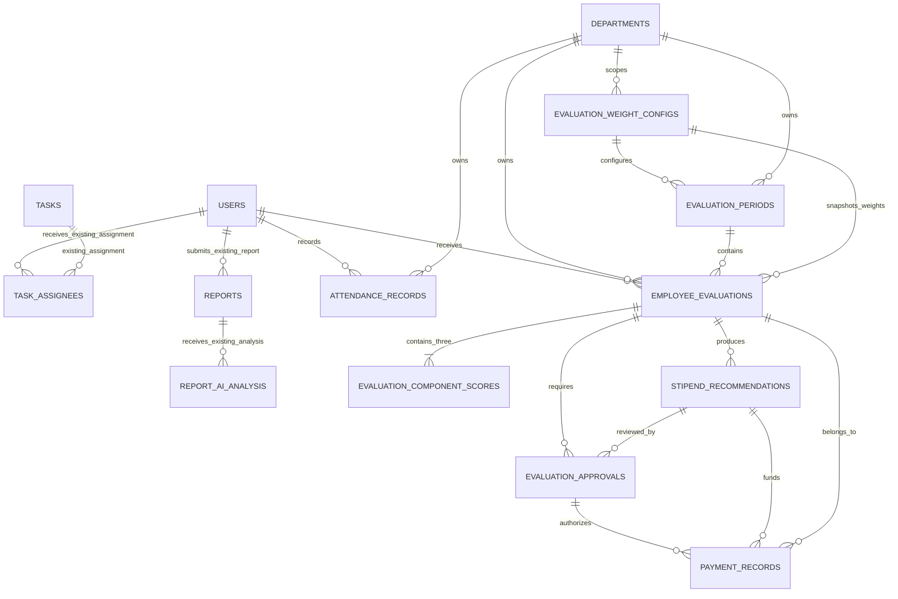

# Report OS Supabase migrations

## Employee evaluation architecture

The evaluation schema is additive. It does not replace or duplicate the existing operational hierarchy:

```text
company_monthly_goals
→ goals
→ department_plans
→ tasks
→ task_assignees
→ reports
→ report_ai_analysis
```

The existing tables remain authoritative for work assignment and reporting:

- `tasks` is the task source of truth.
- `task_assignees` is the employee assignment source of truth.
- `reports` is the employee submission source of truth.
- `report_ai_analysis` is the report-analysis source of truth.
- `users` and `departments` remain the identity and organizational ownership sources of truth.

The employee evaluation extension is:



## Migrations

1. `migrations/202608110001_employee_evaluation_core.sql`
   - Adds tables, constraints, foreign keys, indexes, timestamps, lifecycle checks, scoring triggers, payment authorization checks, and append-only audit triggers.
2. `migrations/202608110002_employee_evaluation_rls.sql`
   - Enables RLS, defines active-user/admin/department ownership helpers, grants table privileges, and creates role-aware policies.
3. `migrations/202608110003_attendance_management.sql`
   - Adds meeting/session details, attendance types, immutable recorder timestamps, optional evaluation-period linkage, multi-session uniqueness, and official manager-only attendance writes.
4. `migrations/202608110004_attendance_performance_scoring.sql`
   - Adds versioned attendance status scoring rules and protects component scores while an evaluation is awaiting or completing approval.
5. `migrations/202608110005_biweekly_evaluation_engine.sql`
   - Adds centralized performance-band policy, advisory stipend percentages, compact calculation snapshots, and server-only calculated-field protections.
6. `migrations/202608110006_evaluation_period_management.sql`
   - Extends the existing department-owned 14-day periods with deadlines, the management lifecycle, concurrent-safe overlap prevention, transactional employee applicability, and lifecycle audit metadata.
7. `migrations/202608110007_evaluation_dashboard_summary.sql`
   - Adds a server-only filtered aggregate function and dashboard indexes so summary statistics come from real evaluation/component/approval records rather than paginated UI approximations.

## Evaluation weights

Weights are versioned in `evaluation_weight_configs`.

The seeded company-wide default is:

| Component | Weight |
|---|---:|
| Task Performance | 50% |
| Reporting Performance | 30% |
| Attendance | 20% |

A database constraint requires the three configured weights to total exactly `100.00`.

Configurations can be company-wide (`department_id IS NULL`) or department-specific. Evaluation periods reference a configuration, and evaluations copy that reference. Once a configuration is used by a period, its ownership, version, weights, and start date become immutable; a new version must be created for future changes.

Each new employee evaluation automatically receives exactly these three component rows:

```text
task_performance
reporting_performance
attendance
```

The component weight is assigned by the database from the evaluation's configuration. `weighted_score` is generated as:

```text
raw_score × weight ÷ 100
```

The central engine calculates `employee_evaluations.overall_score` from the three precise weighted contributions and rounds the final sum once. Any later component mutation invalidates the stored aggregate, band, stipend percentage, and snapshot. An evaluation cannot enter approval or finalization without all three scores, weights totaling 100, and a complete central-engine result.

## Central bi-weekly evaluation engine

`POST /api/evaluations/calculate` orchestrates the existing Task Performance, Reporting Performance, and Attendance Performance services. It does not create separate operational records or alternate component calculations.

The default versioned policy is:

| Overall score | Performance band | Advisory stipend percentage |
|---|---|---:|
| 90–100 | Excellent | 100% |
| 80–89.999 | Very Good | 90% |
| 70–79.999 | Good | 80% |
| 60–69.999 | Needs Improvement | 70% |
| Below 60 | Review Required | Manual decision |

Band rules are stored centrally in `evaluation_weight_configs.performance_band_config`, are validated for complete non-overlapping 0–100 coverage, and become immutable once referenced by an evaluation period. The engine stores classification fields on `employee_evaluations` and a compact `calculation_snapshot` containing component score IDs, formula versions, source cutoffs, configured weights, input summaries, and safeguards. Full explainable evidence remains in each existing `evaluation_component_scores.evidence_metrics` record.

Starting a calculation clears any prior aggregate recommendation and marks the evaluation `incomplete`. A unique run ID and database-maintained component revision ensure an overlapping or out-of-band component update cannot finalize a mismatched snapshot. If a component calculation fails or a concurrent write is detected, the record remains visibly incomplete rather than retaining a stale band or stipend percentage.

Existing evaluations present before this migration remain `not_calculated` until the central engine is run; legacy component evidence, IDs, and stored aggregate values are preserved. API consumers receive `overallScore: null` for these records and may inspect the explicitly labeled `legacyOverallScore` only for historical display. Evaluations already approved before migration may still transition to finalized under their prior approval contract.

Authenticated clients have read-only access to component scores. Calculation writes use authorized server APIs. The engine never changes evaluation approval status, approves a stipend recommendation, creates payment authorization, or marks payment paid; those actions remain separate human-controlled workflows.

## Evaluation source relationships

No evaluation-specific task, plan, goal, report, or assignment table is introduced.

### Task Performance — 50% default

Task metrics must be calculated from existing assignments:

```text
employee_evaluations.employee_id
→ task_assignees.user_id
→ task_assignees.task_id
→ tasks.id
```

Eligible tasks are restricted to the evaluation's stored `department_id`, inclusive period window, and `task_assignees.assigned_at` date so assignments created after the period do not contribute. `lib/server/evaluations/taskPerformanceRepository.js` loads only existing `task_assignees` and `tasks`, then enriches them with the existing weekly plan, goal, company goal, expected output, KPI, report submissions, evidence, review state, and manager comments.

Task Performance uses the versioned deterministic formula `task-performance-v1`:

| Dimension | Weight within Task Performance |
|---|---:|
| Task status/outcome | 35% |
| Expected deliverable satisfaction | 25% |
| KPI progress | 20% |
| Evidence/submission | 15% |
| Human review/manager feedback | 5% |

Task priority controls each task's weight in the normalized employee score. Cancelled tasks remain in the explanation but are excluded from the denominator. If no eligible non-cancelled assigned tasks exist, Task Performance remains unscored instead of treating missing assignments as employee failure. A completed task without linked deliverable support, KPI progress, evidence, and human review is capped below maximum. AI analysis is not used to change task status, completion, evidence, or official results.

The full per-task breakdown is stored in `evaluation_component_scores.evidence_metrics`, including source IDs, dimension scores, reasons, normalized contributions, formula version, source cutoff, and safeguards. The authenticated endpoint is `GET|POST /api/evaluations/task-performance`; only admins and department leads for the evaluation department may calculate, while an employee may retrieve their own stored breakdown.

### Reporting Performance — 30% default

Report metrics must be calculated from existing submissions:

```text
employee_evaluations.employee_id
→ reports.user_id
→ report_ai_analysis.report_id
```

`lib/server/evaluations/reportingPerformanceRepository.js` loads the employee's existing department reports whose `submitted_at` timestamps fall strictly within the evaluation start and end dates. This prevents a report from contributing to two consecutive periods. Until `reports.period_start` and `reports.period_end` are persisted, submission requirements and timeliness use the existing `submitted_at` timestamp. A bi-weekly period produces two weekly reporting checkpoints; each checkpoint is classified as on time, late, or missing.

Reporting Performance uses deterministic formula version `reporting-performance-v1`:

| Dimension | Weight within Reporting Performance |
|---|---:|
| Required submission coverage and timeliness | 25% |
| Report completeness | 15% |
| Task, weekly-plan, department-goal, company-goal, deliverable/KPI alignment | 25% |
| Progress and existing success metrics | 15% |
| Quality and evidence | 15% |
| Human review, manager feedback, and existing risk | 5% |

The layer reuses the latest eligible existing `report_ai_analysis` row for task alignment, goal/company alignment, expected-outcome progress, progress, quality, success rate, risk, and feedback. It does not call the AI provider or create/update any analysis. Missing AI metrics use documented report-content and relationship fallbacks rather than silently failing.

Results are normalized to 0–100 and classified as `Good` (80+), `Average` (60–79.99), or `Poor` (below 60). Workflow classification is `On Track`, `Delayed`, or `Needs Review`. The per-report and checkpoint explanation is stored in `evaluation_component_scores.evidence_metrics`. The authenticated endpoint is `GET|POST /api/evaluations/reporting-performance`; management can calculate and employees can read their own stored result.

### Attendance — 20% default

Attendance metrics come from:

```text
employee_evaluations.employee_id
→ attendance_records.employee_id
```

The attendance date must fall inclusively within `evaluation_periods.start_date` and `evaluation_periods.end_date`, and the stored attendance/evaluation departments must match.

Official records include a meeting/session name, attendance type, status, optional notes, recorder, immutable recorded timestamp, and optional direct `evaluation_period_id`. Multiple sessions can be recorded for the same employee and date, while duplicate employee/date/session/type combinations are prevented.

Employees can read their own attendance through RLS but cannot insert or update official records. Existing management roles—`admin` and department-scoped `department_lead`—record and update attendance. Recorder attribution is derived from `auth.uid()` by the database trigger rather than trusted from browser input.

## Department and historical ownership

Every evaluation has mandatory:

```text
employee_id
evaluation_period_id
department_id
weight_config_id
```

On evaluation creation, database triggers:

1. Read the period's department and weight configuration.
2. Verify the employee currently belongs to that department.
3. Store immutable employee and department name snapshots.
4. Prevent later changes to the evaluation's employee, period, department, weight configuration, or identity snapshots.

Attendance also stores an immutable department snapshot. Historical records therefore remain attached to the department where they were created even if an employee later transfers.

## Status lifecycles

### Evaluation period

```text
Draft → Active → Under Review → Approved → Closed
           ↑             |
           └─────────────┘
```

Periods are exactly 14 inclusive days, cannot overlap within a department, and have an evaluation deadline on or after the end date. Applicable employees are represented by the existing `employee_evaluations` rows; no separate period-employee assignment table exists. Period calculation is allowed only while Active or Under Review and before the evaluation deadline. Period approval requires every non-cancelled employee evaluation to have completed human approval.

Periods are department-specific, non-overlapping, and exactly 14 inclusive calendar days.

### Employee evaluation

```text
draft → scoring → pending_approval → approved → finalized
                       ↘ rejected → scoring
pre-final states → cancelled
```

Finalization requires all three component scores and at least one approved human approval.

### Stipend recommendation

```text
draft → recommended → approved
                   ↘ rejected → superseded
                   ↘ superseded
                   ↘ cancelled
```

A recommendation is advisory. It does not authorize payment.

### Evaluation approval

```text
pending → approved | rejected | changes_requested | cancelled
```

Approvals are sequenced, completed decisions are immutable, the evaluated employee cannot decide their own approval, and an approval linked to a recommendation must reference the same evaluation.

### Payment

```text
pending → scheduled → processing → paid → reversed
       ↘ processing             ↘ failed → processing
       ↘ cancelled              ↘ cancelled
```

Payment creation requires:

- An approved or finalized employee evaluation.
- An approved stipend recommendation for that evaluation.
- An approved human approval for that evaluation and recommendation.
- An amount no greater than the human-approved amount.
- Matching currency.

Employee and department IDs are derived from the evaluation. Financial authorization fields and idempotency keys are immutable. Only one paid payment is allowed per recommendation.

## RLS ownership

- Active employees can read their own attendance, evaluations, component scores, issued recommendations, approvals, payments, and related audit history.
- Department leads can manage evaluation-domain records for their own stored department.
- Admins can manage all evaluation records and are the only existing role allowed to create or process payments.
- Payment and approval rows have no delete policy.
- Audit history has no client write policy and is written only by database triggers.
- The service role bypasses RLS and must only be used behind authenticated and authorized server APIs.

## Audit history

`evaluation_audit_history` captures inserts, updates, and deletes for:

- Weight configurations.
- Evaluation periods.
- Attendance.
- Employee evaluations.
- Component scores.
- Stipend recommendations.
- Evaluation approvals.
- Payments.

It records entity, action, evaluation/employee/department ownership when applicable, actor, old values, new values, and timestamp. It is append-only to application roles.

## Production-data safety

These migrations:

- Create only new tables, functions, indexes, policies, and triggers.
- Do not rename, rewrite, or delete existing IDs or records.
- Do not create replacement task, assignment, plan, goal, report, or AI-analysis tables.
- Use `ON DELETE RESTRICT` for employee evaluation and financial records so historical/financial records cannot be silently removed by deleting an employee or parent record.

Before applying to production, take a schema backup and verify that the deployed `users` and `departments` tables match the UUID relationships represented in the repository's existing SQL artifacts.
